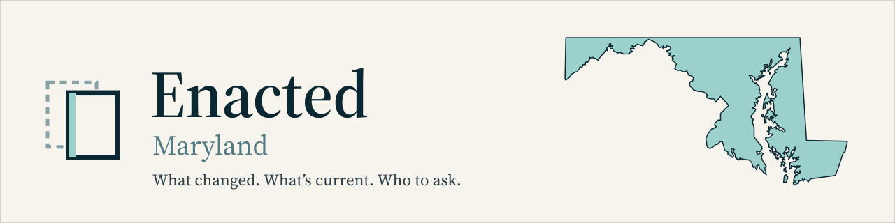

<p align="center">
  <picture>
    <source media="(prefers-color-scheme: dark)" srcset="docs/readme/banner-dark.svg">
    
  </picture>
</p>

<p align="center">
  
  
  
  
  
  <a href="LICENSE-DATA"></a>
  <a href="LICENSE"></a>
</p>

# Enacted: Maryland records

This repository records the enacted law. It does not advise, approve, determine, or certify anything.

Nothing here is legal advice, and using it does not create an attorney-client relationship with anyone. The government source cited in each record controls: a record may have been amended, superseded or corrected since it was fetched. If a decision depends on a rule, read the cited source and, where it matters, ask the office named for that jurisdiction or a licensed professional there.

Browse these records on **[enacted.app](https://enacted.app/coverage/)**, or follow a county by feed at **[enacted.app/feeds](https://enacted.app/feeds/)**. Both are free.

## Contents

- [What's in it](#whats-in-it)
- [Coverage](#coverage)
  - [Water](#water)
  - [Zoning and land use](#zoning-and-land-use)
  - [Statewide law](#statewide-law)
- [How a record is made](#how-a-record-is-made)
  - [Record fields](#record-fields)
- [Checking the records yourself](#checking-the-records-yourself)
- [Reuse and licences](#reuse-and-licences)
- [Corrections](#corrections)
- [About](#about)


## What's in it

| Path | What it holds |
| :-- | :-- |
| `<county>/` | Zoning and land-use records for that jurisdiction, one Markdown file per instrument (council bill, ordinance, zoning text amendment) |
| `<county>/authority.yaml` | Who to ask: the office's public line, quoted from the government's own contact page, with that page's SHA-256 |
| `<county>/SOURCING_BLOCKED.md` | Why a jurisdiction has no records yet |
| `state_statutes/` | Statewide enabling law: Land Use Article Divisions I and II, and the Critical Area Program |
| `water/measurements/<system>/` | Published drinking-water results and notices for each water system (lead, copper, PFOA, PFOS), one file per parameter and year |
| `water/regulator.yaml` | The Maryland Department of the Environment's Water Supply Program line, from a saved, hash-checked page |
| `feeds/` | Atom and JSON feeds built from these records; the checker confirms every item maps to a record |
| `.cache/` | Saved copies of the contact and regulator pages, so their hashes can be recomputed |
| `coverage.json` | Every jurisdiction this repository tracks |
| `verify_corpus_integrity.py`, `tests/`, `scripts/`, `generate_*.py` | The checks, and the deterministic tools that fetch records and build feeds and digests |

## Coverage

Each topic below has a short summary and the full list in a dropdown. The [coverage page](https://enacted.app/coverage/) shows the same thing on a map.

### Water

Drinking-water results and notices from Anne Arundel County's public water systems and WSSC Water, which serves Montgomery and Prince George's counties.

<details>
<summary>All 9 water records</summary>

| Water system | Utility | Serves | Parameter | Period | Record |
| :-- | :-- | :-- | :-- | :-- | :-- |
| Broad Creek | Anne Arundel County DPW | Anne Arundel County | Lead and copper monitoring and reporting | 2025 | [record](water/measurements/aa_broad_creek/lead_copper_violation_2025.md) |
| Crofton/Odenton | Anne Arundel County DPW | Anne Arundel County | Lead and copper monitoring and reporting | 2025 | [record](water/measurements/aa_crofton_odenton/lead_copper_violation_2025.md) |
| Crownsville | Anne Arundel County DPW | Anne Arundel County | Lead | 2023 | [record](water/measurements/aa_crownsville/lead_tap_2025.md) |
| Glen Burnie | Anne Arundel County DPW | Anne Arundel County | Copper | 2023 | [record](water/measurements/aa_glen_burnie/copper_tap_2025.md) |
| Distribution System Customer Taps | WSSC Water | Montgomery County, Prince George's County | Lead | 2023 | [record](water/measurements/wssc_customer_tap/lead_tap_2025.md) |
| Patuxent Water Filtration Plant Tap | WSSC Water | Montgomery County, Prince George's County | PFOA | 2025 | [record](water/measurements/wssc_patuxent/pfoa_2025.md) |
| Patuxent Water Filtration Plant Tap | WSSC Water | Montgomery County, Prince George's County | PFOS | 2025 | [record](water/measurements/wssc_patuxent/pfos_2025.md) |
| Potomac Water Filtration Plant Tap | WSSC Water | Montgomery County, Prince George's County | PFOA | 2025 | [record](water/measurements/wssc_potomac/pfoa_2025.md) |
| Potomac Water Filtration Plant Tap | WSSC Water | Montgomery County, Prince George's County | PFOS | 2025 | [record](water/measurements/wssc_potomac/pfos_2025.md) |

</details>

### Zoning and land use

8 of Maryland's 24 county-level jurisdictions have records.

<details>
<summary>All 24 jurisdictions</summary>

| Jurisdiction | Folder | Status |
| :-- | :-- | :-- |
| Anne Arundel County | [`anne_arundel/`](anne_arundel/) | Records |
| City of Baltimore | [`baltimore_city/`](baltimore_city/) | Records |
| Baltimore County | [`baltimore_county/`](baltimore_county/) | Records |
| Frederick County | [`frederick/`](frederick/) | Records |
| Harford County | [`harford/`](harford/) | Records |
| Howard County | [`howard/`](howard/) | Records |
| Montgomery County | [`montgomery/`](montgomery/) | Records |
| Prince George's County | [`prince_georges/`](prince_georges/) | Records |
| Allegany County | [`allegany/`](allegany/) | Not covered yet: code published only on eCode360 ([details](allegany/SOURCING_BLOCKED.md)) |
| Calvert County | [`calvert/`](calvert/) | Not covered yet: code published only on eCode360 ([details](calvert/SOURCING_BLOCKED.md)) |
| Caroline County | [`caroline/`](caroline/) | Not covered yet: code published only on eCode360 ([details](caroline/SOURCING_BLOCKED.md)) |
| Carroll County | [`carroll/`](carroll/) | Not covered yet: code published only on American Legal Publishing ([details](carroll/SOURCING_BLOCKED.md)) |
| Cecil County | [`cecil/`](cecil/) | Not covered yet: code published only on eCode360 ([details](cecil/SOURCING_BLOCKED.md)) |
| Charles County | [`charles/`](charles/) | Not covered yet: code published only on eCode360 ([details](charles/SOURCING_BLOCKED.md)) |
| Dorchester County | [`dorchester/`](dorchester/) | Not covered yet: no countywide code; town codes only on General Code ([details](dorchester/SOURCING_BLOCKED.md)) |
| Garrett County | [`garrett/`](garrett/) | Not covered yet: no countywide zoning; code only on American Legal Publishing ([details](garrett/SOURCING_BLOCKED.md)) |
| Kent County | [`kent/`](kent/) | Not covered yet: code published only on eCode360 ([details](kent/SOURCING_BLOCKED.md)) |
| Queen Anne's County | [`queen_annes/`](queen_annes/) | Not covered yet: code published only on eCode360 ([details](queen_annes/SOURCING_BLOCKED.md)) |
| Somerset County | [`somerset/`](somerset/) | Not covered yet: no county code online; town codes only on eCode360 ([details](somerset/SOURCING_BLOCKED.md)) |
| St. Mary's County | [`st_marys/`](st_marys/) | Not covered yet: code published only on Municode ([details](st_marys/SOURCING_BLOCKED.md)) |
| Talbot County | [`talbot/`](talbot/) | Not covered yet: code published only on eCode360 ([details](talbot/SOURCING_BLOCKED.md)) |
| Washington County | [`washington/`](washington/) | Not covered yet: code published only on eCode360 ([details](washington/SOURCING_BLOCKED.md)) |
| Wicomico County | [`wicomico/`](wicomico/) | Not covered yet: code published only on eCode360 ([details](wicomico/SOURCING_BLOCKED.md)) |
| Worcester County | [`worcester/`](worcester/) | Not covered yet: code published only on eCode360 ([details](worcester/SOURCING_BLOCKED.md)) |

</details>

### Statewide law

The state laws that county zoning is written under.

<details>
<summary>All 3 statewide records</summary>

| Law | What it covers | Record |
| :-- | :-- | :-- |
| Land Use Article, Division I | Single-jurisdiction planning and zoning (most counties, Baltimore City and municipalities) | [`land_use_article_division_1.md`](state_statutes/land_use_article_division_1.md) |
| Land Use Article, Division II | Maryland-National Capital Park and Planning Commission (Montgomery and Prince George's counties) | [`land_use_article_division_2.md`](state_statutes/land_use_article_division_2.md) |
| Natural Resources Article, Title 8, Subtitle 18 | Chesapeake and Atlantic Coastal Bays Critical Area Protection Program | [`critical_area_program.md`](state_statutes/critical_area_program.md) |

</details>


Records are added and refreshed by deterministic fetch scripts run by hand. Scheduled fetch-and-check workflows are staged in `.github/workflows-pending/` and are not switched on yet, so a change at the source appears here only after the next run.

## How a record is made

- **From the government's own site.** Each record names its source (`primary_source_url`, and `source_pdf` where the instrument is a file), the SHA-256 of the exact file fetched (`source_sha256`) and when it was fetched, in UTC (`source_fetched_at`).
- **Quoted, not summarised.** Quoted text is copied mechanically from that file. Where a title or summary page differs from the enacted text, the enacted text controls and the difference is noted in the record.
- **No commercial code publishers.** Sites such as Municode, American Legal Publishing, eCode360 and enCodePlus are not used. When a jurisdiction's code is published only there, its folder holds a `SOURCING_BLOCKED.md` saying what was checked, and no records.
- **No news or commentary.** Articles and opinion pieces are never cited.
- **No AI models.** Nothing in fetching, building, comparing or sending these records calls a model.

### Record fields

Every legislative record opens with YAML front matter that includes `primary_source_url`, `source_sha256`, `source_fetched_at`, `action_status` and `effective_date`; [PROVENANCE.md](PROVENANCE.md) lists the full set. A date the source doesn't state is written as `[pending verification]`, never left blank.

## Checking the records yourself

```bash
pip install pyyaml jinja2 feedparser pytest
python verify_corpus_integrity.py   # re-fetches cited sources, so it needs network access
python -m pytest tests
```

Every hash can also be checked by hand: download the file a record cites (or open the matching page in `.cache/`) and compare its SHA-256 with the record's `source_sha256`.

## Reuse and licences

- **Records: CC0 1.0** ([LICENSE-DATA](LICENSE-DATA)). The record files and their YAML metadata, the contact files, the feeds, `coverage.json` and the documentation are dedicated to the public domain. Use them for anything, with no permission or credit needed. If you do give credit, a link to the cited government source is the most useful kind.
- **Code: MIT** ([LICENSE](LICENSE)). `verify_corpus_integrity.py`, `generate_feeds.py`, `generate_newsletter.py`, `scripts/`, `tests/` and the workflow files. Keep the copyright notice when you copy them.
- **Not covered by either.** Text quoted from a government document keeps whatever status it has at its source; the dedication covers what Swapp Technologies added (the selection, structure and metadata). The saved pages in `.cache/` belong to their publishers and are kept only so their hashes can be recomputed. The Enacted name, its mark and the images in `docs/readme/` are not licensed.

## Corrections

If you find an error (a wrong date, a broken source link, a quote that doesn't match its source), open an issue on this repository with the record's path and the source you checked. A correction goes through the same checks as every other record.

Enacted can't say whether or how a rule applies to a particular property, project or license. The office listed in that jurisdiction's `authority.yaml` can.

## About

Published by Swapp Technologies LLC (Maryland). The site that presents these records is [enacted.app](https://enacted.app). Developer notes, including how the scheduled workflows are switched on, are in [README-dev.md](README-dev.md).

Related repositories: [enacted-state-dc](https://github.com/Swapp-Technologies-LLC/enacted-state-dc) · [enacted-state-va](https://github.com/Swapp-Technologies-LLC/enacted-state-va) · [enacted-federal](https://github.com/Swapp-Technologies-LLC/enacted-federal)
